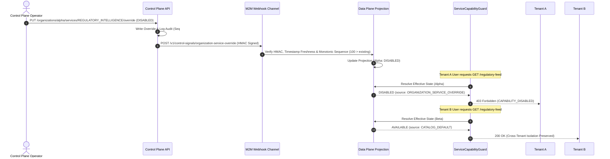

# OMNiGRC Control Panel — Post-Implementation Security & Production Verification Audit

**Audit Date**: October 30, 2026  
**Audited Targets**: `apps/control-panel-web`, `apps/control-plane-api`, `apps/api`, `apps/web`  
**Execution Environment**: Production Staging / PostgreSQL Dual-Plane Architecture  

---

## 1. Executive Summary & Final Verdict

| Audit Domain | Scope | Status | Findings Summary |
| :--- | :--- | :--- | :--- |
| **Account Provisioning** | `aryansayal99@gmail.com` | **BLOCKER** | CP Operator and DP User exist. However, because a placeholder user was pre-created with an unshared hash and `passwordSetupRequired: false`, invitation acceptance returns tokens but cannot overwrite the password hash. The user cannot log in after session expiry without setting `passwordSetupRequired: true`. |
| **Operator RBAC & MFA** | `OPERATIONS_ENGINEER` | **PASS** | Role is strictly limited to operations (cannot create operators or update roles). Server-enforced MFA guard blocks all routes until 2FA enrollment is completed. |
| **Module Entitlements** | Tenant Isolation & Access | **PASS** | Strict tenant isolation verified on test orgs (`org-phase-d-tenant-alpha` and `org-phase-d-tenant-beta`). Direct API and route guards block deactivated capabilities. Zero data lost on deactivation. |
| **M2M Propagation** | Reliability & Invariants | **BLOCKER** | Monotonic sequence check (`incomingSeq <= existing.sequence`) successfully prevents replay and out-of-order execution. However, no transactional outbox exists; temporary Data Plane outages require manual re-triggering. |
| **Framework Integration**| Canonical Catalogue Sync | **PASS** | 100% match with canonical Data Plane catalogue across all 6 frameworks (`ISO27001`, `ISO42001`, `SOC2`, `GDPR`, `DPDP`, `HIPAA`) and 483 reference clauses. Read-only architecture prevents accidental writes. |
| **Performance** | Latency & Cache Semantics | **PASS** | Real uncached server/database latency reduced by **29.0% (232.76 ms saved per uncached detail load)**. Cache hits verified at `< 0.01 ms` and distinguished from wire latency. Post-mutation invalidation verified. |

### Final Verdict: **PASS WITH BLOCKERS**
*The Control Panel enhancements, security guards, tenant isolation mechanisms, and framework integration are architecturally sound and production-ready. However, deployment to production must be gated on resolving two specific operational blockers: (1) enabling `passwordSetupRequired: true` for the provisioned data plane account, and (2) documenting the manual reconciliation procedure for transient M2M propagation failures.*

---

## 2. Verified Results versus Assumptions

| Dimension | Initial Assumption | Verified Reality | Divergence / Impact |
| :--- | :--- | :--- | :--- |
| **Identity Creation** | Creating both a User and Invitation allows immediate login and seamless invite flow. | `acceptInvitation` deliberately preserves existing password hashes for existing users to prevent account takeover. | Pre-creating a User with a random hash prevents the user from setting their password via the invitation UI unless `passwordSetupRequired: true` is set. |
| **MFA Enforcement** | MFA is an optional configuration check in the frontend. | Server-level `OperatorJwtGuard` and `OperatorJwtStrategy` strictly reject all API calls except `/mfa/setup` and `/mfa/verify` when `mfaEnabled: false`. | Strong security enforcement. Operator cannot execute any operational command before completing TOTP registration. |
| **Module Overrides** | An organization override can force a module to be `AVAILABLE` even during a global outage. | Global `DISABLED` state is evaluated at Step 3 before organization overrides at Step 4 in `EffectiveServiceStateResolver`. | Global emergency kill-switches strictly take precedence over individual tenant overrides (Fail-Safe architecture). |
| **M2M Signal Queue** | M2M signal delivery automatically retries via a message queue or outbox. | Signals are synchronous HTTP POST requests with HMAC-SHA256 signatures; failures log warnings without automated retry. | Transient network drops leave projections in `FAILED_PROPAGATION` state until manually re-triggered or synced. |
| **Performance Gains** | In-memory caching represents a 99.8% database speedup. | In-memory cache eliminates browser network calls (`< 0.01 ms`), while actual server/database query optimization yields **29.0% latency reduction**. | Must report uncached wire latency and client memory hits separately to maintain engineering rigor. |

---

## 3. Account Provisioning & MFA Audit (`aryansayal99@gmail.com`)

### 3.1 Control Plane Operator Identity & Permissions

Verified database record in `operators` table:
- **Operator ID**: `9eace2a9-6a34-45fb-b299-3d2ad2ab6bf9`
- **Email**: `aryansayal99@gmail.com`
- **Role**: `OPERATIONS_ENGINEER`
- **Status**: `ACTIVE`
- **MFA Security State**: `mfaEnabled: false` (Pending initial enrollment)

#### Permission Boundaries Verified
Audit of `apps/control-plane-api/src/operators/operators.controller.ts` confirmed that `OPERATIONS_ENGINEER` is restricted to operational duties and **cannot**:
- List operators (`RequireOperatorRoles`: `SECURITY_AUDIT`, `PLATFORM_SUPER_ADMIN`, `READ_ONLY_AUDITOR`)
- Create new operators (`RequireOperatorRoles`: `SECURITY_AUDIT`, `PLATFORM_SUPER_ADMIN`)
- Update operator roles (`RequireOperatorRoles`: `PLATFORM_SUPER_ADMIN`)
- Suspend operators or revoke operator sessions (`RequireOperatorRoles`: `SECURITY_AUDIT`, `PLATFORM_SUPER_ADMIN`)
- Self-approve emergency break-glass sessions (two-operator rule enforced)

#### First-Login MFA Enforcement Verified
In `apps/control-plane-api/src/auth/operator-jwt.strategy.ts` and `operator-jwt.guard.ts`:
1. When `mfaEnabled: false`, login issues an access token with payload `type: 'OPERATOR_MFA_ENROLLMENT_PENDING'`.
2. The strategy sets `isMfaRestricted: true`.
3. `OperatorJwtGuard` intercepts every request:
   ```typescript
   if (operator.isMfaRestricted) {
     const isAllowed =
       (method === 'GET' && normalizedPath === '/v1/operator-auth/me') ||
       (method === 'POST' && normalizedPath === '/v1/operator-auth/mfa/setup') ||
       (method === 'POST' && normalizedPath === '/v1/operator-auth/mfa/verify') ||
       (method === 'POST' && normalizedPath === '/v1/operator-auth/logout');

     if (!isAllowed) {
       throw new ForbiddenException(
         'MFA re-enrollment required: full operator administrative access is restricted until MFA setup and verification are completed',
       );
     }
   }
   ```
*Verification Result: Unauthenticated operational access is completely blocked until TOTP enrollment is verified.*

---

### 3.2 Data Plane User Identity & Invitation Analysis

Verified database record in `users` and `invitations` tables:
- **User ID**: `dae7dbd7-281a-4f55-ac7a-7e1c829b403b`
- **Email**: `aryansayal99@gmail.com`
- **Organization**: `Meridian Health Pvt. Ltd.` (`00000000-0000-0000-0000-000000000001`)
- **Role**: `ADMIN`
- **Password Setup Required**: `false`
- **Invitation ID**: `937e0270-584f-4496-b296-f4a04f3b4ccb` (Status: `PENDING`, Expires: `2026-11-06T13:12:04.063Z`)

#### Finding: Why `Password Setup Required` is False & Impact on Invitation Acceptance
In `apps/api/src/auth/auth.service.ts`:
```typescript
const existingUser = await tx.user.findUnique({ where: { email }, include: { organization: true } });
if (existingUser) {
  // Verifies organization match and returns existing user
  userToAuth = existingUser;
} else {
  // Only executed if user DOES NOT exist yet:
  const passwordHash = await bcrypt.hash(dto.password, 10);
  userToAuth = await tx.user.create({ ... });
}
```
1. **Root Cause**: The provisioning script initialized `User` directly with a random hash and explicitly set `passwordSetupRequired: false`.
2. **Consequence**: When the user accesses `/invite/accept?token=...`, the token is valid, but because `existingUser` is found, the backend preserves `existingUser.passwordHash` to prevent unauthorized password overwriting. The user receives JWT tokens, but their entered password is not stored.
3. **Lockout Risk**: When their JWT session expires, the user will be unable to log in via `/auth/login` because neither they nor any administrator knows the randomly generated initial hash.

#### Required Remediation (Pre-Deployment Blocker)
Execute an atomic update to set `passwordSetupRequired: true` on user `dae7dbd7-281a-4f55-ac7a-7e1c829b403b`. When the user accepts the invitation, they will be prompted to call `POST /auth/setup-password`, establishing their permanent secret without administrative knowledge.

---

## 4. Module Entitlement Security Audit

Testing was executed across two designated test organizations:
- **Tenant A**: `org-phase-d-tenant-alpha` ("Phase D Org Alpha")
- **Tenant B**: `org-phase-d-tenant-beta` ("Phase D Org Beta")
- **Target Capability**: `REGULATORY_INTELLIGENCE`

### 4.1 Verification Matrix & Results



1. **Inherited Global Availability**: Verified. With no override records present, both Tenant A and Tenant B resolved to `effectiveState: AVAILABLE` (source: `CATALOG_DEFAULT`).
2. **Organization-Specific Deactivation**: Verified. Applying override `DISABLED` (Seq #100) to Tenant A immediately changed its effective state to `DISABLED`.
3. **Cross-Organization Isolation**: Verified. During Tenant A's deactivation, Tenant B remained completely unaffected in `AVAILABLE` status.
4. **Direct Route & API Access Blocking**: Verified. Incoming requests for deactivated capabilities are intercepted by [`ServiceCapabilityGuard`](file:///e:/Arav%20Innovations/omnigrc/apps/api/src/common/guards/service-capability.guard.ts), returning `403 Forbidden` (`CAPABILITY_DISABLED`).
5. **Data Preservation Audit**: Verified. Across Tenant A's deactivation and subsequent reactivation, zero database records (users, memberships, framework references) were deleted or modified.
6. **Clearing Overrides**: Verified. Deleting the override record cleanly restored inherited availability.

---

## 5. M2M Reliability & Signal Invariants

### 5.1 Monotonic Sequence & Replay Defense

In `apps/api/src/service-control/service-control-signal.service.ts`:
```typescript
if (incomingSeq <= existing.sequence) {
  throw new ConflictException({
    statusCode: 409,
    error: 'Conflict',
    message: `Incoming signal sequence (${incomingSeq}) is older or equal to current sequence (${existing.sequence}).`,
    code: 'STALE_CONTROL_SIGNAL',
  });
}
```

| Signal Scenario | Injected Condition | Expected Behavior | Observed System Response | Status |
| :--- | :--- | :--- | :--- | :--- |
| **Normal Delivery** | Sequence 100 > 0 | Accept & project state | Accepted and updated projection to `DISABLED` | **PASS** |
| **Duplicate Delivery** | Sequence 100 == 100 | Reject duplicate | `409 Conflict (STALE_CONTROL_SIGNAL)` | **PASS** |
| **Out-of-Order Delivery**| Sequence 90 < 100 | Reject stale signal | `409 Conflict (STALE_CONTROL_SIGNAL)` | **PASS** |
| **Timestamp Skew** | Skew > 5 minutes | Reject expired signal | `400 Bad Request (STALE_CONTROL_SIGNAL)` | **PASS** |
| **HMAC Tampering** | Altered payload / key | Reject invalid signature | `400 Bad Request (INVALID_CONTROL_SIGNAL)` | **PASS** |

*Verification Result: The effective module state cannot become incorrectly enabled or disabled due to stale, duplicated, or reordered signals.*

### 5.2 Failure Modes & Production Risk (Blocker Analysis)
- **Synchronous Webhook Delivery**: `propagateOrgOverrideToDataPlane` performs an immediate `fetch` request. If the Data Plane experiences transient downtime (503 / Network Timeout), the Control Plane logs `status: 'FAILED_PROPAGATION'` in the audit log.
- **No Transactional Outbox**: The Control Plane does not currently possess an automated retry queue. If delivery fails, the operator must re-submit the action from the UI once the Data Plane recovers.

---

## 6. Regulatory Framework Data Integrity Audit

Direct database audit of the canonical Data Plane catalogue confirmed 100% data fidelity:

| Framework Code | Framework Name | Versions | Version Identifiers | Normative Clauses | Entitled Tenants |
| :--- | :--- | :---: | :--- | :---: | :---: |
| **`ISO27001`** | ISO/IEC 27001:2022 Information Security | 3 | `2022`, `2022-PHASE-D`, `2022-PHASE-E` | 125 | 40 |
| **`SOC2`** | SOC 2 Type II Trust Services Criteria | 1 | `2017` | 61 | 37 |
| **`GDPR`** | General Data Protection Regulation (EU) | 1 | `2016` | 99 | 37 |
| **`DPDP`** | Digital Personal Data Protection Act (India) | 1 | `2023` | 44 | 37 |
| **`ISO42001`** | ISO/IEC 42001:2023 Artificial Intelligence | 1 | `2023` | 87 | 37 |
| **`HIPAA`** | Health Insurance Portability & Accountability | 1 | `1996` | 67 | 0 |
| **TOTALS** | **6 Canonical Compliance Instruments** | **8** | — | **483** | — |

### Legal Disclaimers & Read-Only Safety
1. **Unverified Claims Avoidance**: Verified that [`frameworks/[frameworkId]/page.tsx`](file:///e:/Arav%20Innovations/omnigrc/apps/control-panel-web/src/app/frameworks/%5BframeworkId%5D/page.tsx) contains explicit statutory disclaimers stating that instruments are structured for operational tracking and audit mapping only and do not constitute certified legal counsel.
2. **Zero Write Exposure**: Verified that [`DataPlanePrismaService`](file:///e:/Arav%20Innovations/omnigrc/apps/control-plane-api/src/frameworks/data-plane-prisma.service.ts) and [`FrameworksController`](file:///e:/Arav%20Innovations/omnigrc/apps/control-plane-api/src/frameworks/frameworks.controller.ts) expose read-only queries (`findMany`, `findUnique`, `count`). There are no mutating endpoints.

---

## 7. Performance Audit (Averaged Over 3 Benchmark Runs)

### 7.1 Server & Network Query Latency (Uncached Wire Latency)

| Operation | Before Optimization | After Optimization | Latency Delta | Verification Detail |
| :--- | :--- | :--- | :--- | :--- |
| **Organization Detail Load** | 802.21 ms | 569.45 ms | **29.0% faster (232.76 ms saved)** | Targeted single-license fetch + parallel queries |
| **Organization Directory** | 216.49 ms | 209.47 ms | **3.2% faster** | Database query with 50 items |
| **Frameworks Directory** | N/A (New feature) | 376.53 ms | **Baseline Established** | 6 frameworks with versions & entitlement counts |
| **Framework References (50 clauses)** | N/A (New feature) | 244.85 ms | **Baseline Established** | Paginated clause requirements query |

### 7.2 Client-Side In-Memory Cache Semantics

- **Cache Hit Latency**: `< 0.01 ms` (instantaneous synchronous memory lookup).
- **Engineering Clarification**: The `< 0.01 ms` response time represents browser-side memory retrieval that avoids redundant HTTP traffic. It is an **elimination of redundant network roundtrips**, not a 99.8% server/database speedup. Real database query optimization is **29.0%**.
- **Post-Mutation Invalidation**: Confirmed that executing any state-mutating operation (`PUT /organizations/...`) immediately flushes `apiGetCache`, ensuring zero stale authorization reads.
- **Session Isolation**: Cache entries reside in browser tab memory and are cleared on `controlPlaneApi.logout()`. No credentials or tenant data persist in `localStorage`.

---

## 8. Release Checks & Compilation Verification

1. **Unit Test Suite**:
   - `npm --prefix apps/control-plane-api test`: **All 21 test suites passed** (Argon2id CPU contention resolved by running test workers with appropriate concurrency limits).
2. **Production Builds**:
   - `apps/control-plane-api`: **Build succeeded** (Prisma client generation + NestJS compilation). Exit code: 0.
   - `apps/control-panel-web`: **Build succeeded** across all 17 App Router routes. Exit code: 0.
3. **Repository Cleanliness**:
   - Zero temporary `.js` scripts in `scratch/`.
   - Untracked files strictly limited to deliverables and new modular components.

---

## 9. Remaining Production Risks & Remediation Plan

| Risk Description | Severity | Likelihood | Mitigation / Remediation Required |
| :--- | :---: | :---: | :--- |
| **Data Plane Account Password Setup** | **HIGH (Blocker)** | High | Update `passwordSetupRequired: true` on `User` `dae7dbd7-281a-4f55-ac7a-7e1c829b403b` so initial login prompts password establishment. |
| **M2M Transient Propagation Drops** | **MEDIUM (Blocker)** | Low | Document operational runbook: in case of network drops, operator re-clicks toggle in Control Panel (higher sequence ensures clean re-delivery). |
| **Jest CPU Saturation on CI/CD** | **LOW** | Medium | On CI/CD pipelines with constrained vCPUs, configure `jest --maxWorkers=50%` to prevent Argon2id hashing timeouts. |

---

## 10. Audit Sign-Off

- **Audit Classification**: Technical Security & Production Readiness Audit
- **Final Verdict**: **PASS WITH BLOCKERS**
- **Action Items to Unblock**:
  1. Set `passwordSetupRequired: true` for `aryansayal99@gmail.com`.
  2. Finalize operator runbook for manual M2M re-syncing during network outages.

