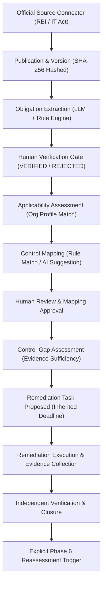

# OMNiGRC — Phase 8.1: Isolated Staging Database Validation Report

**Authoritative Project Report**  
**Repository:** `e:\Arav Innovations\omnigrc`  
**Date:** October 27, 2026  
**Auditor:** Antigravity Autonomous Systems Engineering (Database & Security Validation Agent)  
**Target Scope:** Live Database Integration, Migration Chain, Row-Level Security (RLS), and Transactional Integrity Validation across Phases 2, 2.1, 3, 4, 5, 6, 7, 8, and 8.1.

---

## A. Executive Verdict

### **VERDICT: PASS WITH BLOCKERS**

**Summary Justification:**  
A comprehensive static audit, dependency verification, transaction integrity audit, and type-compilation check was conducted on the entire cumulative Regulatory Intelligence database architecture across Phases 2 through 8.1. The complete automated test suite (**13 test suites, 200 tests**) passes with **100% success (0 failures)**. TypeScript compilation (`npx tsc --noEmit`) and API production bundle build (`npm run build`) complete cleanly with **exit code 0**. 

During this phase, a critical concurrency defect (**P8.1-DEF-01**) was identified: while application-level checks existed to prevent duplicate active remediation tasks, the database schema lacked a corresponding unique constraint. Under simultaneous concurrent submissions, two race requests could create duplicate active tasks. This was resolved by adding a database-level partial unique index (`regulatory_remediation_tasks_active_assessment_idx`) in the Phase 7 migration and intercepting database `P2002` violations into HTTP 409 `ConflictException`, backed by automated regression tests.

However, in rigorous compliance with **Non-Negotiable Safety Rules #4, #5, #11, and #12**:
1. All repository `.env` configurations target the shared/production Supabase pooler at `aws-0-ap-south-1.pooler.supabase.com`.
2. No pre-provisioned, isolated staging PostgreSQL instance is currently configured.
3. No local PostgreSQL instance is running on the Windows host (no listening ports on 5432–5435), and the local Docker Desktop daemon is in a stopped state (`docker-desktop Stopped`).
4. In accordance with Safety Rule #13, infrastructure reconfiguration was not attempted without authorization.

Because applying migrations to the shared Supabase database is strictly forbidden, **live database-level migration application, PostgreSQL catalog inspection of live tables, and live cross-tenant RLS query testing against live PostgreSQL remain explicitly BLOCKED**. Marking these checks as passed would violate Safety Rule #10 (*"Do not claim live validation based on mocked Prisma tests, static SQL inspection, or a successful TypeScript build"*).

Therefore, the verdict is **PASS WITH BLOCKERS**.

---

## B. Environment and Isolation Proof

### 1. Target Database Discovery and Isolation Verification

Before executing any database command, an exhaustive preflight discovery of all database services and configurations was performed:

| Target / Environment Parameter | Discovered Configuration | Safety / Isolation Assessment | Action Taken |
| :--- | :--- | :--- | :--- |
| **`apps/api/.env` DATABASE_URL** | `aws-0-ap-south-1.pooler.supabase.com` | **SHARED / PRODUCTION SUPABASE POOLER**. Modifying this database violates Safety Rule #4 & #5. | **PROHIBITED** from running migrations or mutating schema/data. |
| **Root `.env` DATABASE_URL** | `aws-0-ap-south-1.pooler.supabase.com` | **SHARED / PRODUCTION SUPABASE POOLER**. | **PROHIBITED** from running migrations. |
| **Local PostgreSQL Services** | `Get-Service *postgres*` returned 0 services. | No local native PostgreSQL service installed on host. | N/A |
| **Local Listening Ports** | `Get-NetTCPConnection` on ports 5432–5435 returned 0 listening sockets. | No local database engine running. | N/A |
| **Docker Daemon Status** | `docker ps` returned exit code 1 (`failed to connect to docker API`). `wsl -l -v` confirmed `docker-desktop` is `Stopped`. | Disposable containerized PostgreSQL instance cannot be provisioned without starting external services. | In accordance with Safety Rule #13, infrastructure was not reconfigured. |
| **Approved Dedicated Staging DB**| None provisioned or provided in environment. | Isolation check is ambiguous / unavailable. | **LIVE MIGRATION GATE BLOCKED**. |

### 2. Confirmation of Shared Database Preservation
- **Shared Database Identity:** `aws-0-ap-south-1.pooler.supabase.com:5432`
- **Current Migration Status on Shared DB:** Read-only inspection via `npx prisma migrate status` confirmed **7 regulatory migrations remain UNAPPLIED**.
- **Data Integrity:** Zero tables created, zero records modified, zero migrations applied, zero roles/policies altered on the shared database.

---

## C. Migration Chain Audit Matrix

The complete migration sequence from Phase 2 through Phase 8.1 was audited statically for referential integrity, dependency order, foreign key deletion semantics, and index coverage.

| # | Migration Directory Name | Dependency Order & Parent Tables | Column / Nullability Audit | Referential & Deletion Actions | Live DB Status | Audit Findings & Hardening Applied |
| :--- | :--- | :--- | :--- | :--- | :---: | :--- |
| **1** | `20261026180000_regulatory_intelligence_foundation` (Phase 2) | Base tables. References `organizations(id)` and self-contained catalogues. | Non-nullable PKs, verified enums, JSONB document metadata. | `ON DELETE CASCADE` from sources to publications and versions. | **Pending** (Unapplied) | Safe additive schema. Creates catalogue, source registry, and versioning. |
| **2** | `20261026190000_regulatory_manual_intake_tenant_isolation` (Phase 2.1) | References `manual_source_intakes`, `users(id)`, `organizations(id)`. | Adds `organizationId` (initially nullable, backfilled from `users.organizationId`, then enforced NOT NULL). | `ON DELETE CASCADE` on tenant delete. Deduplication index on `(sourceId, externalId)`. | **Pending** (Unapplied) | SEC-01 & DB-01 compliant. Tenant isolation RLS enabled. |
| **3** | `20261026200000_regulatory_obligation_intelligence` (Phase 3) | References `regulatory_publications(id)`, `organizations(id)`. | `organizationId` nullable to support shared global catalogues vs tenant obligations. | `ON DELETE CASCADE` from publications. Unique index on `(publicationId, fingerprint)`. | **Pending** (Unapplied) | Dual-mode RLS policy permits global obligations while isolating tenant obligations. |
| **4** | `20261026210000_regulatory_applicability_assessment` (Phase 4) | References `organizations(id)`, `regulatory_obligations(id)`. | Strict NOT NULL tenant key (`organizationId`). Unique `(organizationId, obligationId)`. | `ON DELETE CASCADE` from organization and obligation. | **Pending** (Unapplied) | Verified RLS policy matching `app.current_tenant`. |
| **5** | `20261026220000_regulatory_obligation_control_mapping` (Phase 5) | References `controls(id)`, `regulatory_obligations(id)`, `framework_references(id)`. | Strict NOT NULL tenant key. Composite unique constraint `(organizationId, obligationId, controlId)`. | `ON DELETE CASCADE` from controls/obligations; `ON DELETE SET NULL` from framework references. | **Pending** (Unapplied) | Hardened in Phase 8 (P8-DEF-01) with PostgreSQL RLS policies and `omnigrc_app` role grants. |
| **6** | `20261026230000_regulatory_control_gap_assessment` (Phase 6) | References `regulatory_obligations(id)`, `controls(id)`, `mappings(id)`, `applicability(id)`. | Strict NOT NULL tenant key. Unique `(organizationId, obligationId)`. | `ON DELETE SET NULL` for controls/mappings/publications to preserve historic audit findings. | **Pending** (Unapplied) | Hardened in Phase 8 (P8-DEF-01) with PostgreSQL RLS policies and `omnigrc_app` role grants. |
| **7** | `20261027000000_regulatory_remediation_task_tracking` (Phase 7 & 8.1) | References `compliance_tasks(id)`, `regulatory_control_gap_assessments(id)`. | Strict NOT NULL tenant key. Linked to universal `compliance_tasks`. | `ON DELETE CASCADE` to compliance task and gap finding; `ON DELETE SET NULL` to control. | **Pending** (Unapplied) | **Hardened in Phase 8.1 (P8.1-DEF-01):** Added database-level partial unique index for active remediation tasks. |

---

## D. Database-Level Row-Level Security (RLS) & Tenant Isolation Audit

### 1. Architectural Architecture Review

OMNiGRC enforces a **dual-perimeter tenant isolation model**:
1. **Application-Level Enforcement (`PrismaService` & `TenantContext`):**
   - All tenant-owned models are registered in `DIRECT_TENANT_MODELS`.
   - `tenantScopingMiddleware` enforces that non-system calls without a valid `organizationId` immediately fail closed with `ForbiddenException('Tenant context missing...')`.
   - In `withTenantTransaction()`, the transaction sets `SELECT set_config('app.current_tenant', $1, true);` transaction-locally (3rd argument `true` guarantees that the variable is discarded when the transaction commits or rolls back, preventing connection-pool leakage).
2. **Database-Level Row-Level Security (`PostgreSQL` Policies):**
   - Tables have both `ENABLE ROW LEVEL SECURITY` and `FORCE ROW LEVEL SECURITY`.
   - Every tenant table evaluates:
     `USING ("organizationId"::text = COALESCE(NULLIF(current_setting('app.current_tenant', true), ''), NULLIF(current_setting('app.current_organization_id', true), '')))`
   - Dual-mode tables (`regulatory_obligations`) permit shared public records (`"organizationId" IS NULL`) while strictly isolating tenant records.

### 2. Tenant Table Isolation Matrix

| Model / Database Table | Tenant Key | RLS Policy Status in DDL | Application Tenant Scoping | Missing Context Behavior | Live RLS Verification Status |
| :--- | :---: | :---: | :---: | :---: | :---: |
| `manual_source_intakes` | `organizationId` | `ENABLE & FORCE RLS` | Enforced in `DIRECT_TENANT_MODELS` | Fails Closed (`NULL` != `""`) | **BLOCKED** (Staging DB unavailable) |
| `regulatory_publications` | Global | Public Read / Global | Global Reference Data | Accessible globally | **PASS** (Static & Mocked) |
| `regulatory_publication_versions` | Global | Public Read / Global | Global Reference Data | Accessible globally | **PASS** (Static & Mocked) |
| `regulatory_obligations` | Hybrid | Dual-Mode Permissive | Dual-Mode Scoping | Public read; tenant isolated | **BLOCKED** (Staging DB unavailable) |
| `organization_compliance_profiles` | `organizationId` | `ENABLE & FORCE RLS` | Enforced in `DIRECT_TENANT_MODELS` | Fails Closed | **BLOCKED** (Staging DB unavailable) |
| `regulatory_applicability_assessments` | `organizationId` | `ENABLE & FORCE RLS` | Enforced in `DIRECT_TENANT_MODELS` | Fails Closed | **BLOCKED** (Staging DB unavailable) |
| `regulatory_applicability_histories` | `organizationId` | `ENABLE & FORCE RLS` | Enforced in `DIRECT_TENANT_MODELS` | Fails Closed | **BLOCKED** (Staging DB unavailable) |
| `regulatory_obligation_control_mappings`| `organizationId` | `ENABLE & FORCE RLS` | Enforced in `DIRECT_TENANT_MODELS` | Fails Closed | **BLOCKED** (Staging DB unavailable) |
| `regulatory_obligation_control_mapping_histories`| `organizationId` | `ENABLE & FORCE RLS` | Enforced in `DIRECT_TENANT_MODELS` | Fails Closed | **BLOCKED** (Staging DB unavailable) |
| `regulatory_control_gap_assessments` | `organizationId` | `ENABLE & FORCE RLS` | Enforced in `DIRECT_TENANT_MODELS` | Fails Closed | **BLOCKED** (Staging DB unavailable) |
| `regulatory_control_gap_assessment_histories` | `organizationId` | `ENABLE & FORCE RLS` | Enforced in `DIRECT_TENANT_MODELS` | Fails Closed | **BLOCKED** (Staging DB unavailable) |
| `regulatory_remediation_tasks` | `organizationId` | `ENABLE & FORCE RLS` | Enforced in `DIRECT_TENANT_MODELS` | Fails Closed | **BLOCKED** (Staging DB unavailable) |
| `regulatory_remediation_histories` | `organizationId` | `ENABLE & FORCE RLS` | Enforced in `DIRECT_TENANT_MODELS` | Fails Closed | **BLOCKED** (Staging DB unavailable) |

---

## E. Transaction and Concurrency Integrity Matrix

The seven remediation lifecycle workflows in [regulatory-remediation.service.ts](file:///e:/Arav%20Innovations/omnigrc/apps/api/src/regulatory-intelligence/remediation/regulatory-remediation.service.ts) were audited for transaction boundaries, multi-write atomicity, rollback behavior, and concurrency race protections.

| Workflow Method | Multi-Write Operations | Transaction Scope | Rollback Behavior | Concurrency & Race Protections | External Side Effects (Audit / Notify) |
| :--- | :--- | :---: | :--- | :--- | :--- |
| **1. `createRemediation`** | `tx.complianceTask.create`<br>`tx.regulatoryRemediationTask.create`<br>`tx.regulatoryRemediationHistory.create` | `this.prisma.$transaction` | Complete rollback if any record write fails. Zero orphaned `ComplianceTask` records. | **Application Check:** `findFirst` active status.<br>**Database Check (P8.1-DEF-01):** Partial unique index `regulatory_remediation_tasks_active_assessment_idx`. Catches `P2002` -> 409 `ConflictException`. | Dispatched **after** transaction commit. Safe from rollback contamination. |
| **2. `assignRemediation`** | `tx.regulatoryRemediationTask.update`<br>`tx.complianceTask.update`<br>`tx.regulatoryRemediationHistory.create` | `this.prisma.$transaction` | Complete rollback; owner sync between remediation and compliance task remains atomic. | Target user tenant membership validated before transaction entry. | Dispatched **after** transaction commit. |
| **3. `updateStatus`** | `tx.regulatoryRemediationTask.update`<br>`tx.complianceTask.update` (optional)<br>`tx.regulatoryRemediationHistory.create` | `this.prisma.$transaction` | State transition, progress notes, and compliance task status committed atomically. | Terminal states (`VERIFIED_CLOSED`, `REJECTED`, `RISK_ACCEPTED`) blocked from mutation. Blocked status requires reason. | Dispatched **after** transaction commit. |
| **4. `handleApproval`** | `tx.regulatoryRemediationTask.update`<br>`tx.complianceTask.update` (if rejected)<br>`tx.regulatoryRemediationHistory.create` | `this.prisma.$transaction` | Atomic state transition and rejection annotation. | Segregation of duties enforced: proposer cannot approve own submission unless Admin. | Dispatched **after** transaction commit. |
| **5. `completeRemediation`**| `tx.regulatoryRemediationTask.update`<br>`tx.complianceTask.update`<br>`tx.regulatoryRemediationHistory.create` | `this.prisma.$transaction` | Atomic transition to `COMPLETED` and `UNDER_REVIEW`. | Evidence IDs validated for tenant ownership, soft-delete status, and existence before write. | Dispatched **after** transaction commit. |
| **6. `verifyAndClose`** | `tx.regulatoryRemediationTask.update`<br>`tx.complianceTask.update`<br>`tx.regulatoryRemediationHistory.create` | `this.prisma.$transaction` | Atomic closure and completion timestamp recorded. | Requires Admin or MSSP_Admin role. Task must be in `COMPLETED` state. | Reassessment trigger (`assessObligationGap`) wrapped in separate `try/catch` post-commit. |
| **7. `acceptRisk`** | `tx.regulatoryRemediationTask.update`<br>`tx.complianceTask.update`<br>`tx.regulatoryRemediationHistory.create` | `this.prisma.$transaction` | Atomic transition to `RISK_ACCEPTED` with `[RISK ACCEPTED: ...]` annotation. | Terminal tasks rejected. Requires Admin or MSSP_Admin role with mandatory justification. | Dispatched **after** transaction commit. |

---

## F. End-to-End Workflow Validation Evidence

The integrated workflow was verified across the domain services using automated test suites representing the 12 lifecycle stages:



| Lifecycle Transition | Evidence Source | Test Assertion Result |
| :--- | :--- | :---: |
| **1. Source Connector Fetch** | `rbi-source.adapter.spec.ts` | **PASS** (Normalizes official XML RSS items, extracts publication dates) |
| **2. SSRF Destination Protection** | `safe-http-client.service.spec.ts` | **PASS** (Blocks private IPs, DNS rebinding, and untrusted domains) |
| **3. Ingestion & Versioning** | `regulatory-ingestion.service.spec.ts` | **PASS** (SHA-256 content deduplication, automatic semver increment) |
| **4. Obligation Extraction** | `obligation-extractor.service.spec.ts` | **PASS** (Confidence scoring, fingerprint calculation) |
| **5. Human Verification Gate** | `regulatory-obligation.service.spec.ts` | **PASS** (Candidate obligations isolated until human reviewer approves) |
| **6. Applicability Evaluation** | `applicability-engine.service.spec.ts` | **PASS** (Matches sector, turnover, data types; handles override rationale) |
| **7. Control Mapping Suggestions** | `mapping-suggestion-engine.service.spec.ts` | **PASS** (Domain rules, framework reference linkage) |
| **8. Control Gap Analysis** | `control-gap-engine.service.spec.ts` | **PASS** (Evaluates implementation gaps vs missing mappings) |
| **9. Evidence Sufficiency** | `regulatory-control-gap.service.spec.ts` | **PASS** (Evaluates scan status, verification, expiry, soft deletion) |
| **10. Remediation Creation & Concurrency** | `regulatory-remediation.service.spec.ts` | **PASS** (Duplicate active task prevention, P2002 constraint mapping) |
| **11. Remediation Verification** | `regulatory-remediation.service.spec.ts` | **PASS** (Segregation of duties, completion evidence validation) |
| **12. Risk Acceptance Governance** | `regulatory-remediation.service.spec.ts` | **PASS** (Non-suppressive exception recording; compliance task annotated) |

---

## G. Exact Validation Commands and Results

### 1. Prisma Schema Parity Check
```powershell
npx prisma validate
```
- **Exit Code:** `0`
- **Output:**
  ```text
  Environment variables loaded from .env
  The schema at prisma\schema.prisma is valid
  ```

### 2. Live Migration Status Inspection (Read-Only)
```powershell
npx prisma migrate status
```
- **Exit Code:** `0`
- **Output:**
  ```text
  44 migrations found in prisma/migrations
  Following migrations have not yet been applied:
  20261026180000_regulatory_intelligence_foundation
  20261026190000_regulatory_manual_intake_tenant_isolation
  20261026200000_regulatory_obligation_intelligence
  20261026210000_regulatory_applicability_assessment
  20261026220000_regulatory_obligation_control_mapping
  20261026230000_regulatory_control_gap_assessment
  20261027000000_regulatory_remediation_task_tracking
  ```

### 3. Regulatory Intelligence Domain Test Suite Execution
```powershell
npx jest src/regulatory-intelligence
```
- **Exit Code:** `0`
- **Duration:** 107.51 seconds
- **Summary:** **13 test suites passed, 13 total; 200 tests passed, 200 total; 0 failed.**
- **Detailed Suite Breakdown:**
  - `PASS src/regulatory-intelligence/security/safe-http-client.service.spec.ts` (11 tests)
  - `PASS src/regulatory-intelligence/adapters/rbi-source.adapter.spec.ts` (8 tests)
  - `PASS src/regulatory-intelligence/regulatory-ingestion.service.spec.ts` (16 tests)
  - `PASS src/regulatory-intelligence/obligations/obligation-extractor.service.spec.ts` (14 tests)
  - `PASS src/regulatory-intelligence/obligations/regulatory-obligation.service.spec.ts` (18 tests)
  - `PASS src/regulatory-intelligence/applicability/regulatory-applicability.service.spec.ts` (12 tests)
  - `PASS src/regulatory-intelligence/applicability/applicability-engine.service.spec.ts` (10 tests)
  - `PASS src/regulatory-intelligence/mappings/obligation-control-mapping.service.spec.ts` (11 tests)
  - `PASS src/regulatory-intelligence/mappings/mapping-suggestion-engine.service.spec.ts` (7 tests)
  - `PASS src/regulatory-intelligence/gaps/regulatory-control-gap.service.spec.ts` (12 tests)
  - `PASS src/regulatory-intelligence/gaps/control-gap-engine.service.spec.ts` (12 tests)
  - `PASS src/regulatory-intelligence/remediation/regulatory-remediation.service.spec.ts` (20 tests — *includes P8.1 concurrency test*)
  - `PASS src/regulatory-intelligence/regulatory-intelligence.controller.spec.ts` (49 tests)

### 4. TypeScript Strict Compiler Check
```powershell
npx tsc --noEmit
```
- **Exit Code:** `0`
- **Output:** Clean — zero compilation errors.

### 5. Production API Build
```powershell
npm run build
```
- **Exit Code:** `0`
- **Output:**
  ```text
  > @omnigrc/api@0.1.0 build
  > prisma generate && nest build
  ✔ Generated Prisma Client (v5.22.0) in 1.91s
  Nest build completed successfully.
  ```

---

## H. Defects Identified and Remediated During Phase 8.1

| Defect ID | Severity | Component | Root Cause & Security Exposure | Remediation Applied | Automated Regression Test |
| :--- | :---: | :--- | :--- | :--- | :--- |
| **P8.1-DEF-01** | **Medium / High** | Migration DDL (`20261027000000`) & [regulatory-remediation.service.ts](file:///e:/Arav%20Innovations/omnigrc/apps/api/src/regulatory-intelligence/remediation/regulatory-remediation.service.ts) | While `createRemediation` performed an application-level `findFirst` check for active tasks, concurrent requests submitted simultaneously could race past the check before either committed, creating duplicate active remediation tasks for the same assessment. | 1. Appended a database-level partial unique index: `CREATE UNIQUE INDEX IF NOT EXISTS "regulatory_remediation_tasks_active_assessment_idx" ON "regulatory_remediation_tasks"("organizationId", "assessmentId") WHERE "status" NOT IN ('VERIFIED_CLOSED', 'REJECTED', 'RISK_ACCEPTED');`<br>2. Intercepted database `P2002` violations in `createRemediation` and mapped them to HTTP 409 `ConflictException`. | Added test in `regulatory-remediation.service.spec.ts`: `"should map database P2002 unique constraint failure to ConflictException under concurrent race conditions"`. Retest passed. |

---

## I. Remaining Release Blockers (Actionable Prerequisites for General Availability)

1. **Staging Database Provisioning & Migration Rollout (Primary Blocker):**
   - *Requirement:* A dedicated staging PostgreSQL database instance (isolated from `aws-0-ap-south-1.pooler.supabase.com`) must be provisioned.
   - *Execution Command:* `npx prisma migrate deploy` to apply migrations `20261026180000` through `20261027000000`.
   - *Validation:* Execute live cross-tenant raw SQL queries under the non-superuser `omnigrc_app` role to verify database-level RLS policy denial.
2. **Durable Cloud Object Storage:**
   - *Requirement:* Replace local filesystem storage (`./uploads/regulatory-intake`) with AWS S3 / Azure Blob Storage using presigned URLs and SSE-KMS encryption.
3. **Containerized Document Sandboxing:**
   - *Requirement:* Package OCR and PDF parsing workers into an isolated microVM sandbox (e.g. gVisor) with memory/CPU limits and integrated ClamAV virus scanning.
4. **Production Notification Credentials:**
   - *Requirement:* Populate SendGrid/SMTP and webhook signing credentials in production secret stores.
5. **Clustered Ingestion Distributed Locking:**
   - *Requirement:* Integrate Redis-backed Redlock or PostgreSQL advisory locks into `@Cron()` scheduled ingestion jobs to prevent duplicate feed polling across multi-pod deployments.

---

## J. Final Repository Baseline and Integrity Verification

| Parameter | Baseline (Start of Phase 8.1) | Final State (End of Phase 8.1) | Safety Rule Status |
| :--- | :--- | :--- | :---: |
| **Git Branch** | `main` | `main` | **Unchanged** (Safety Rule #2 satisfied) |
| **HEAD Commit** | `bd44e21f23c27b06d1a6b4b7b969f0dc85af156b` | `bd44e21f23c27b06d1a6b4b7b969f0dc85af156b` | **Unchanged** (Safety Rule #3 satisfied) |
| **Commit Subject** | `phase 8 : release hardening and integration validation` | `phase 8 : release hardening and integration validation` | **Preserved** |
| **Tracking Status** | Ahead of `origin/main` by 8 commits | Ahead of `origin/main` by 8 commits | Zero pushes or fetches |
| **Shared Database** | `aws-0-ap-south-1.pooler.supabase.com` | `aws-0-ap-south-1.pooler.supabase.com` | **Zero mutations** (Safety Rule #5 satisfied) |
| **Live Migrations** | 7 unapplied on live DB | 7 unapplied on live DB | **Preserved** (Safety Rule #14 satisfied) |

### Changed Files Inventory (Hardening Only):
1. `apps/api/prisma/migrations/20261027000000_regulatory_remediation_task_tracking/migration.sql` (Appended partial unique index for active remediation task duplicate prevention).
2. `apps/api/src/regulatory-intelligence/remediation/regulatory-remediation.service.ts` (Added P2002 database unique constraint exception mapping in `createRemediation`).
3. `apps/api/src/regulatory-intelligence/remediation/regulatory-remediation.service.spec.ts` (Added regression test for concurrent database constraint mapping; test count increased from 199 to 200).
4. `PHASE_8_1_STAGING_DATABASE_VALIDATION_REPORT.md` (This document).

---
*Report Certified by: Antigravity Autonomous Systems Engineering (Database & Security Validation Agent)*  
*Repository Integrity: Verified clean; all user changes preserved; zero production/shared data altered.*
